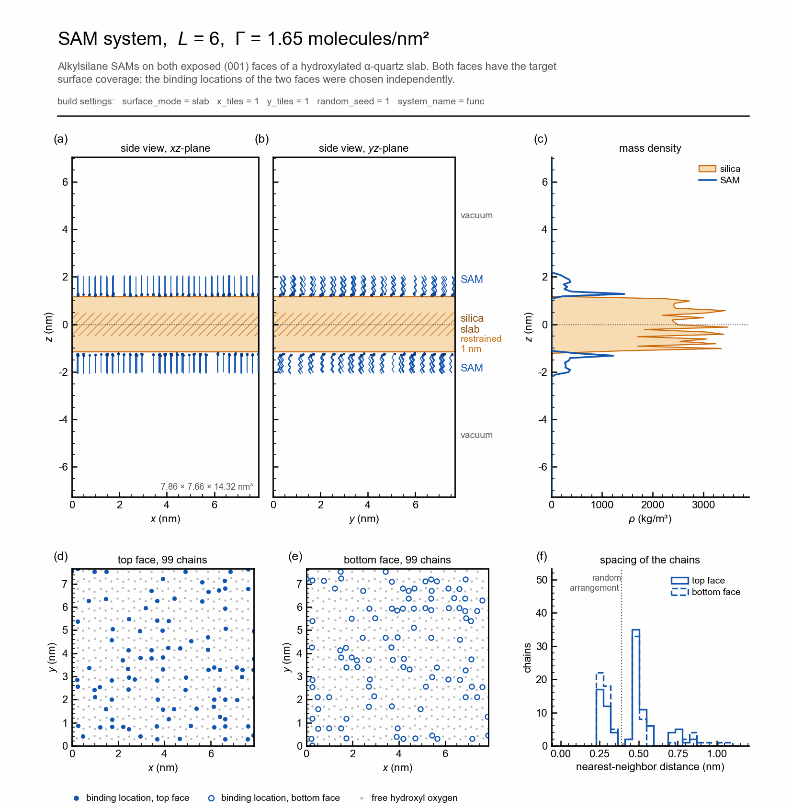

# apadana

apadana builds all-atom models of alkylsilane self-assembled monolayers (SAMs) on a hydroxylated
α-quartz (001) silica slab and prepares them for molecular dynamics simulations with GROMACS [1].
For every system, one folder is written with the structure, the topology, the force-field files,
the run parameters of all simulation stages and the job scripts, together with a one-page
overview sheet of the built system.

<p align="center">
  
</p>
<p align="center">
  <sub>Upper part of the overview sheet of a system with chain length <i>L</i> = 6 and coverage
  Γ = 1.65 molecules/nm<sup>2</sup>: side views of the box, mass density along <i>z</i>, binding
  locations of the chains on both faces of the slab and their nearest-neighbor distances.</sub>
</p>


## Model systems

The substrate is a slab of α-quartz SiO<sub>2</sub> whose hydroxylated (001) surfaces are exposed
on both sides. The slab is periodic in the *xy*-plane, its surface normal is along the *z*-axis,
and each face carries 9.56 OH groups per nm<sup>2</sup>. The relaxed slab included in the package
measures 7.86 · 7.66 · 2.23 nm<sup>3</sup> and consists of 12096 atoms.

Alkylsilane molecules with *L* carbon atoms in the alkyl chain are grafted on both faces of the
slab. For a coverage Γ (molecules/nm<sup>2</sup>), the number of molecules on a face follows from
the face area. Every molecule is bonded through a Si–O–Si bridge to a hydroxyl group of the surface,
which is chosen at random and loses its hydrogen atom. Both faces receive the same number of
molecules, but their binding locations are drawn independently, so the two faces are two different
random arrangements of the same SAM. The chains start in the all-*trans* conformation, aligned with
the surface normal. A vacuum region of 6 nm is left on both sides of the slab.


## Installation

apadana requires Python 3.10 with mBuild 0.16 and foyer 0.12. They are installed most easily with
conda:

```bash
conda create -n apadana_env python=3.10 -y
conda activate apadana_env
conda install -c mosdef -c conda-forge mbuild=0.16.0 foyer=0.12.1 parmed matplotlib -y
pip install setuptools==69.5.1
```

Then, in the folder of this repository:

```bash
pip install .
```

The version of setuptools is fixed as in the tested environment, since mBuild 0.16 relies on its
older `pkg_resources` module.
GROMACS (2023 or later) is needed to run the simulations, but not to build the systems.


## Building a system

```python
from apadana import build_sam_system

build_sam_system(chain_length=8, coverage=2.40, output_folder='L8_G2.40', random_seed=1)
```

`chain_length` is *L* and `coverage` is Γ in molecules/nm<sup>2</sup>. With `random_seed`, every
build gives the same binding locations; without it, every build is a new random arrangement.
All options are listed in [`examples/build_example.py`](examples/build_example.py).

The silica slab is relaxed before the chains are grafted on it. The slab is chosen with
`surface_mode`:

| `surface_mode` | Silica slab | Use |
| --- | --- | --- |
| `'slab'` (default) | relaxed slab of the package, 7.86 · 7.66 nm | SAM systems on this slab |
| `'cell'` | `x_tiles` · `y_tiles` α-quartz unit cells (8 · 9 if not given) | new slab of another size, built with `coverage=0` and relaxed in GROMACS |
| `'user'` | `.gro` or `.pdb` file given as `user_surface` | SAM systems on a slab relaxed by the user |

A new slab and the files for its relaxation are made with

```python
build_sam_system(chain_length=0, coverage=0, surface_mode='cell', x_tiles=10, y_tiles=12,
                 output_folder='slab_10x12')
```

The script `run_surface_relaxation.sh` of this folder performs an energy minimization and a 10 ns
NPT simulation, in which the C-rescale barostat changes only the *xy*-dimensions of the slab.
The relaxed slab, `surface/2_npt_crescale/confout.gro`, is then used for the SAM systems:

```python
build_sam_system(chain_length=8, coverage=2.40, surface_mode='user',
                 user_surface='confout.gro', output_folder='L8_G2.40')
```

With `coverage=0` and the surface mode `'slab'` or `'user'`, the pristine slab is prepared for the
same dry and wet simulations as the SAM systems.


## Simulation workflow

Every system is simulated dry, surrounded by vacuum, and wet, immersed in water. The grafted chains
of a freshly built system are often strained, so the systems are equilibrated stepwise, with time
steps that increase as the system becomes stable, before the production runs:

| State | Stage | Run | Time step (fs) | Length (ns) | Restrained silica |
| --- | --- | --- | --- | --- | --- |
| dry | 1 | energy minimization (steepest descent) | - | - | whole slab |
| dry | 2 | NVT | 0.25 | 1 | whole slab |
| dry | 3 | NVT | 0.5 | 1 | whole slab |
| dry | 4 | NVT | 1 | 1 | whole slab |
| dry | 5 | NVT, equilibration | 2 | 20 | centermost 1 nm |
| dry | 6 | NVT, production | 2 | 100 | centermost 1 nm |
| wet | 1 | solvation of the end of dry stage 5 (`gmx solvate`, TIP3P) | - | - | - |
| wet | 2 | energy minimization (steepest descent) | - | - | centermost 1 nm |
| wet | 3 | NVT | 0.25 | 1 | centermost 1 nm |
| wet | 4 | NVT | 0.5 | 1 | centermost 1 nm |
| wet | 5 | NVT | 1 | 1 | centermost 1 nm |
| wet | 6 | NPT, C-rescale, water slab thickness | 1 | 10 | centermost 1 nm |
| wet | 7 | NVT, equilibration | 2 | 20 | centermost 1 nm |
| wet | 8 | NPT, Parrinello-Rahman, production | 2 | 100 | centermost 1 nm |

The temperature is kept at 298.15 K by the V-rescale thermostat [2] with a time constant of 0.2 ps.
The cut-off of the real-space Lennard-Jones and Coulomb interactions is 1.2 nm, with a force switch
from 1.0 nm on for the Lennard-Jones forces, and the long-range part of the electrostatics is
handled by particle-mesh Ewald [3] (Fourier spacing 0.12 nm, interpolation order 4). Bonds to
hydrogen atoms are constrained with LINCS. Both barostats of the wet systems, C-rescale [4] and
Parrinello-Rahman [5], are semi-isotropic: the *xy*-dimensions, set by the silica slab, stay fixed,
and only the *z*-dimension follows the pressure of 1 bar (compressibility 4.5 · 10<sup>-5</sup>
bar<sup>-1</sup>). Position restraints of 1000 kJ mol<sup>-1</sup> nm<sup>-2</sup> keep the silica in
place: on the whole slab in the first dry stages and on its centermost 1 nm afterwards. All run
parameters can be changed in [`apadana/workflow.py`](apadana/workflow.py) and in the `.mdp`
templates of [`apadana/data/mdp`](apadana/data/mdp).

The four job scripts are written for SLURM. `bash submit_all.sh` submits them with the dependencies
between them: the dry production and the wet relaxation start after the dry relaxation, and the wet
production after the wet relaxation. The account, the partition and the other job settings are
given as `hpc={'account': ..., 'partition': ...}` (see `HPC_DEFAULTS` in `apadana/workflow.py`) or
edited in the scripts. Finished stages are skipped and an interrupted stage continues from its
checkpoint, so a job that reached its time limit is submitted again as it is. The input files of
all stages can be checked with `gmx grompp` alone, without running the simulations:

```bash
GMX=gmx LAUNCH= GROMPP_ONLY=1 bash run_dry_relaxation.sh
```


## Output

```
L8_G2.40/
    README.md                   summary of the system and of the workflow
    system_overview.pdf         one-page overview sheet (also as .png)
    system/                     func.gro, func.pdb, func.mol2   coordinates
                                func.itp                        atoms, charges, masses and bonded terms
                                topol.top, topol_wet.top        topologies of the dry and the wet system
                                index.ndx                       groups Surface, Ots, Ots1 ... and midSurface
                                POSRES_SUR.itp, POSRES_MIDSUR.itp, POSRES_OTS.itp
                                ForceField/                     force-field files
    mdp/                        run parameters of every stage
    run_dry_relaxation.sh   run_dry_production.sh   run_wet_relaxation.sh   run_wet_production.sh
    workflow_functions.sh   submit_all.sh
```

The stages run in `dry/<n>_<stage>/` and `wet/<n>_<stage>/`, and the production runs end in
`dry/6_production_nvt/` and `wet/8_production_npt/`.

The files follow the GROMACS conventions: lengths in nm, energies in kJ/mol and the origin of the
box at one of its corners. In the overview sheet and in the README of a system, *z* is measured from
the geometrical center of the silica slab; the README gives the position of this center in the box.

Atom names are SI, OS (bridging oxygen), OD and HD (hydroxyl group) and OP (oxygen bonded to a chain)
for the silica, residue SUR; SI1, O1, O2, H1, H2 and C1 ... C*L* with their hydrogen atoms for the
alkylsilanes, residue OTS, with the carbon atoms numbered from the silicon to the chain end; and
OH2, H1 and H2 for the water, residue TIP3. Every chain is a residue of its own and has its own group
in the index file.


## Force fields

Three force fields are combined: INTERFACE for the silica [6], CHARMM36 for the alkylsilanes
[7, 8] and the CHARMM TIP3P model for the water [8, 9]. The parameters of the bonded terms around the
Si–C bond at the grafting point are given in `ForceField/charmm_sam_connection_point.ff`. Atom types
are assigned with foyer [10] from `apadana/data/forcefield/EMAMI_CHARMM.xml`, and the molecules are
assembled with mBuild [11].

The `ForceField` folder includes third-party files: the GROMACS port of CHARMM36 (July 2022) made
with charmm2gmx, the water model converted with CHARMM-GUI, and the INTERFACE parameters for silica.
The α-quartz unit cell was generated with CHARMM-GUI [12]. The original headers of these files are
kept.


## References

1. M. J. Abraham et al., GROMACS: High performance molecular simulations through multi-level
   parallelism from laptops to supercomputers, *SoftwareX* **1–2**, 19–25 (2015).
2. G. Bussi, D. Donadio and M. Parrinello, Canonical sampling through velocity rescaling,
   *J. Chem. Phys.* **126**, 014101 (2007).
3. T. Darden, D. York and L. Pedersen, Particle mesh Ewald: An N·log(N) method for Ewald sums in
   large systems, *J. Chem. Phys.* **98**, 10089–10092 (1993).
4. M. Bernetti and G. Bussi, Pressure control using stochastic cell rescaling, *J. Chem. Phys.*
   **153**, 114107 (2020).
5. M. Parrinello and A. Rahman, Polymorphic transitions in single crystals: A new molecular
   dynamics method, *J. Appl. Phys.* **52**, 7182–7190 (1981).
6. F. S. Emami et al., Force field and a surface model database for silica to simulate interfacial
   properties in atomic resolution, *Chem. Mater.* **26**, 2647–2658 (2014).
7. B. R. Brooks et al., CHARMM: the biomolecular simulation program, *J. Comput. Chem.* **30**,
   1545–1614 (2009).
8. A. D. MacKerell Jr. et al., All-atom empirical potential for molecular modeling and dynamics
   studies of proteins, *J. Phys. Chem. B* **102**, 3586–3616 (1998).
9. W. L. Jorgensen et al., Comparison of simple potential functions for simulating liquid water,
   *J. Chem. Phys.* **79**, 926–935 (1983).
10. C. Klein et al., Formalizing atom-typing and the dissemination of force fields with foyer,
    *Comput. Mater. Sci.* **167**, 215–227 (2019).
11. C. Klein et al., A hierarchical, component based approach to screening properties of soft
    matter, in *Foundations of Molecular Modeling and Simulation*, Springer, 79–92 (2016).
12. Y. K. Choi et al., CHARMM-GUI Nanomaterial Modeler for modeling and simulation of nanomaterial
    systems, *J. Chem. Theory Comput.* **18**, 479–493 (2022).


## Author

Kourosh Hasheminejad


## License

MIT, see [LICENSE](LICENSE).
