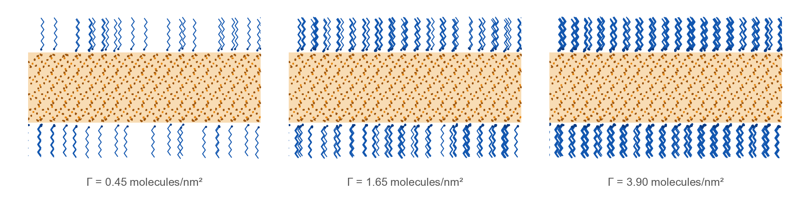
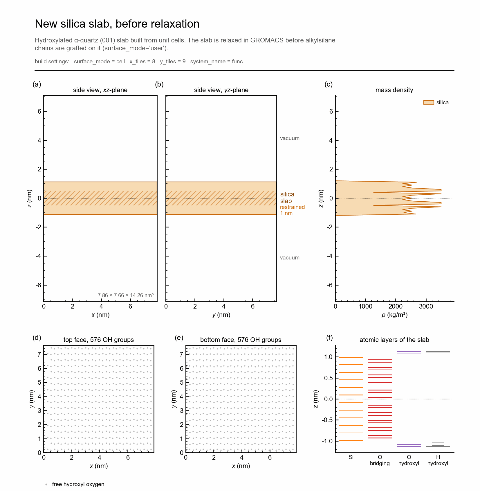

<p align="center">
  <picture>
    <source media="(prefers-color-scheme: dark)" srcset="docs/images/banner_dark.png">
    
  </picture>
</p>

<h1 align="center">apadana</h1>

<p align="center">
  <b>All-atom models of alkylsilane self-assembled monolayers on silica, prepared for GROMACS</b>
</p>

<p align="center">
  
  
  
  
</p>

<p align="center">
  <a href="#model-systems">Model systems</a> &nbsp;·&nbsp;
  <a href="#installation">Installation</a> &nbsp;·&nbsp;
  <a href="#building-a-system">Building a system</a> &nbsp;·&nbsp;
  <a href="#simulation-workflow">Simulation workflow</a> &nbsp;·&nbsp;
  <a href="docs/output_files.md">Output files</a> &nbsp;·&nbsp;
  <a href="#test-case">Test case</a>
</p>

<br>

apadana builds all-atom models of alkylsilane self-assembled monolayers (SAMs) on a hydroxylated
α-quartz (001) silica slab and prepares them for molecular dynamics simulations with GROMACS [1].
For every system, one folder is written with the structure, the topology, the force-field files,
the run parameters of all simulation stages and the job scripts, together with a one-page
overview sheet of the built system. The banner above shows SAMs of chain length *L*&nbsp;=&nbsp;8 at the
coverages Γ&nbsp;=&nbsp;0.45, 1.65 and 3.90 molecules/nm<sup>2</sup>, as built by apadana.


## What apadana does

<table>
<tr>
<th width="33%">Build</th>
<th width="33%">Simulate</th>
<th width="34%">Check and report</th>
</tr>
<tr>
<td valign="top">

- Alkylsilanes of any chain length *L* and coverage Γ on both faces of the slab
- Independent random binding locations on the two faces, reproducible with a seed
- The relaxed slab of the package, new slabs of any size from unit cells, or a slab of the user
- The pristine slab (Γ&nbsp;=&nbsp;0)

</td>
<td valign="top">

- GROMACS structure, molecule and topology files with their force fields
- Index groups with one group per chain, and position restraints
- Run parameters of every dry and wet stage, solvation included
- SLURM job scripts that skip finished stages and continue interrupted ones
- Relaxation of new slabs before chains are grafted on them

</td>
<td valign="top">

- Check of the input files of all stages with `gmx grompp` alone
- README of every system
- One-page overview sheet of every system
- Test case, with a test that builds it again and compares every file

</td>
</tr>
</table>


## Overview sheet

Every build ends with a one-page summary of the system: side views of the box to scale, the mass
density along *z*, the binding locations of the chains on both faces and their spacing, and tables
of the system data and of the simulation workflow.

<table>
<tr>
<td width="50%"></td>
<td width="50%"></td>
</tr>
<tr>
<td align="center"><sub>SAM system with <i>L</i>&nbsp;=&nbsp;6 and Γ&nbsp;=&nbsp;1.65 molecules/nm<sup>2</sup> (the test case)</sub></td>
<td align="center"><sub>New silica slab of 8 · 9 unit cells, before its relaxation</sub></td>
</tr>
</table>


## Model systems

The substrate is a slab of α-quartz SiO<sub>2</sub> whose hydroxylated (001) surfaces are exposed
on both sides. The slab is periodic in the *xy*-plane, its surface normal is along the *z*-axis,
and each face carries 9.56 OH groups per nm<sup>2</sup>. The relaxed slab included in the package
measures 7.86 · 7.66 · 2.23 nm<sup>3</sup> and consists of 12096 atoms.

Alkylsilane molecules with *L* carbon atoms in the alkyl chain are grafted on both faces of the
slab. For a coverage Γ (molecules/nm<sup>2</sup>), the number of molecules on a face follows from
the face area. Every molecule is bonded through a Si–O–Si bridge to a hydroxyl group of the surface,
which is chosen at random and loses its hydrogen atom. Both faces receive the same number of
molecules, but their binding locations are drawn independently, so the two faces are two different
random arrangements of the same SAM. The chains start in the all-*trans* conformation, aligned with
the surface normal. A vacuum region of 6 nm is left on both sides of the slab.


## Installation

apadana requires Python 3.10 with mBuild 0.16 and foyer 0.12, which are installed with conda:

```bash
conda create -n apadana_env python=3.10 -y
conda activate apadana_env
conda install -c mosdef -c conda-forge mbuild=0.16.0 foyer=0.12.1 parmed matplotlib -y
pip install setuptools==69.5.1
```

Then, in the folder of this repository:

```bash
pip install .
```

> **Note**
>
> The version of setuptools is fixed as in the tested environment, since mBuild 0.16 relies on its
> older `pkg_resources` module. GROMACS (2023 or later) is needed to run the simulations, but not to
> build the systems.


## Building a system

```python
from apadana import build_sam_system

build_sam_system(chain_length=8, coverage=2.40, output_folder='L8_G2.40', random_seed=1)
```

`chain_length` is *L* and `coverage` is Γ in molecules/nm<sup>2</sup>. With `random_seed`, every
build gives the same binding locations; without it, every build is a new random arrangement. A
build of a system on the slab of the package takes about 10 minutes.

<details>
<summary><b>All arguments of <code>build_sam_system</code></b></summary>
<br>

| Argument | Default | Meaning |
| --- | --- | --- |
| `chain_length` | | number of carbon atoms in the alkyl chain, *L* |
| `coverage` | | coverage Γ on each face (molecules/nm<sup>2</sup>); 0 for a slab without chains |
| `surface_mode` | `'slab'` | silica slab: `'slab'`, `'cell'` or `'user'` (see below) |
| `user_surface` | `None` | `.gro` or `.pdb` file of the slab for `surface_mode='user'` |
| `x_tiles`, `y_tiles` | `None` | repeats of the silica structure in *x* and *y*; 8 and 9 in `'cell'` mode, 1 otherwise |
| `vacuum_space_nm` | `6` | empty space above and below the slab (nm) |
| `restrained_layer_nm` | `1` | width of the restrained centermost layer of the slab (nm) |
| `surface_resname` | `'SUR'` | residue name of the silica |
| `sam_resname` | `'OTS'` | residue name of the alkylsilanes |
| `system_name` | `'func'` | base name of the structure and topology files |
| `output_folder` | `'.'` | folder of the system; it is created if it does not exist |
| `random_seed` | `None` | integer that makes the binding locations reproducible |
| `hpc` | `None` | SLURM settings of the job scripts (see [Simulation workflow](#simulation-workflow)) |
| `make_plot` | `True` | write the overview sheet |

A commented example with all arguments is [`examples/build_example.py`](examples/build_example.py).

</details>

### Silica slab

The silica slab is relaxed before the chains are grafted on it. The slab is chosen with
`surface_mode`:

| `surface_mode` | Silica slab | Use |
| --- | --- | --- |
| `'slab'` (default) | relaxed slab of the package, 7.86 · 7.66 nm | SAM systems on this slab |
| `'cell'` | `x_tiles` · `y_tiles` α-quartz unit cells (8 · 9 if not given) | new slab of another size, built with `coverage=0` and relaxed in GROMACS |
| `'user'` | `.gro` or `.pdb` file given as `user_surface` | SAM systems on a slab relaxed by the user |

A new slab and the files for its relaxation are made with

```python
build_sam_system(chain_length=0, coverage=0, surface_mode='cell', x_tiles=10, y_tiles=12,
                 output_folder='slab_10x12')
```

The script `run_surface_relaxation.sh` of this folder performs an energy minimization and a 10 ns
NPT simulation, in which the C-rescale barostat changes only the *xy*-dimensions of the slab.
The relaxed slab, `surface/2_npt_crescale/confout.gro`, is then used for the SAM systems:

```python
build_sam_system(chain_length=8, coverage=2.40, surface_mode='user',
                 user_surface='confout.gro', output_folder='L8_G2.40')
```

With `coverage=0` and the surface mode `'slab'` or `'user'`, the pristine slab is prepared for the
same dry and wet simulations as the SAM systems. Chains can also be grafted directly on unit cells
(`surface_mode='cell'` with a coverage above 0); apadana then notes that the slab was not relaxed.

### Other tools

- `plot_system` draws the overview sheet of a built system again, for example
  `plot_system('L8_G2.40/system/func.gro', 'sheet.pdf', 8, 2.40)`.
- `Alkylsilane(n_ch2=L - 1)` makes single alkylsilane molecules: `capped_molecule()` gives the free
  molecule with three OH groups on the silicon, `for_top_face()` and `for_bottom_face()` the
  molecules for grafting, and `save_files(molecule, name)` writes a molecule as `.pdb`, `.mol2` and
  `.xyz`.
- `functionalizer(...)`, the function of apadana 3, is kept with its arguments, so older scripts
  still run.


## Simulation workflow

Every system is simulated dry, surrounded by vacuum, and wet, immersed in water. The grafted chains
of a freshly built system are often strained, so the systems are equilibrated stepwise, with time
steps that increase as the system becomes stable, before the production runs:

| State | Stage | Run | Time step (fs) | Length (ns) | Restrained silica |
| :---: | :---: | --- | :---: | :---: | --- |
| dry | 1 | energy minimization (steepest descent) | - | - | whole slab |
| dry | 2 | NVT | 0.25 | 1 | whole slab |
| dry | 3 | NVT | 0.5 | 1 | whole slab |
| dry | 4 | NVT | 1 | 1 | whole slab |
| dry | 5 | NVT, equilibration | 2 | 20 | centermost 1 nm |
| dry | 6 | **NVT, production** | 2 | 100 | centermost 1 nm |
| wet | 1 | solvation of the end of dry stage 5 (`gmx solvate`, TIP3P) | - | - | - |
| wet | 2 | energy minimization (steepest descent) | - | - | centermost 1 nm |
| wet | 3 | NVT | 0.25 | 1 | centermost 1 nm |
| wet | 4 | NVT | 0.5 | 1 | centermost 1 nm |
| wet | 5 | NVT | 1 | 1 | centermost 1 nm |
| wet | 6 | NPT, C-rescale, water slab thickness | 1 | 10 | centermost 1 nm |
| wet | 7 | NVT, equilibration | 2 | 20 | centermost 1 nm |
| wet | 8 | **NPT, Parrinello-Rahman, production** | 2 | 100 | centermost 1 nm |

<details>
<summary><b>Run parameters</b></summary>
<br>

The temperature is kept at 298.15 K by the V-rescale thermostat [2] with a time constant of 0.2 ps.
The cut-off of the real-space Lennard-Jones and Coulomb interactions is 1.2 nm, with a force switch
from 1.0 nm on for the Lennard-Jones forces, and the long-range part of the electrostatics is
handled by particle-mesh Ewald [3] (Fourier spacing 0.12 nm, interpolation order 4). Bonds to
hydrogen atoms are constrained with LINCS. Both barostats of the wet systems, C-rescale [4] and
Parrinello-Rahman [5], are semi-isotropic: the *xy*-dimensions, set by the silica slab, stay fixed,
and only the *z*-dimension follows the pressure of 1 bar (compressibility 4.5 · 10<sup>-5</sup>
bar<sup>-1</sup>). Position restraints of 1000 kJ mol<sup>-1</sup> nm<sup>-2</sup> keep the silica in
place: on the whole slab in the first dry stages and on its centermost 1 nm afterwards. The lengths
and time steps of the stages are set in the stage tables of [`apadana/workflow.py`](apadana/workflow.py),
and all other run parameters in the `.mdp` templates of [`apadana/data/mdp`](apadana/data/mdp).

</details>

<details>
<summary><b>Job scripts and settings</b></summary>
<br>

The four job scripts are written for SLURM. `bash submit_all.sh` submits them with the dependencies
between them: the dry production and the wet relaxation start after the dry relaxation, and the wet
production after the wet relaxation. The job settings are given to `build_sam_system` as a
dictionary, for example `hpc={'account': 'my_account', 'partition': 'batch'}`, with the keys
`account`, `partition`, `nodes`, `ntasks_per_node`, `cpus_per_task`, `time_relaxation`,
`time_production`, `modules`, `gmx`, `launcher` and `mdrun_options` (defaults in `HPC_DEFAULTS` of
`apadana/workflow.py`), or edited in the scripts. Finished stages are skipped and an interrupted
stage continues from its checkpoint, so a job that reached its time limit is submitted again as it
is.

</details>

The input files of all stages can be checked with `gmx grompp` alone, without running the
simulations:

```bash
GMX=gmx LAUNCH= GROMPP_ONLY=1 bash run_dry_relaxation.sh
```


## Output

```
L8_G2.40/
    README.md                   summary of the system and of the workflow
    system_overview.pdf         one-page overview sheet (also as .png)
    system/                     coordinates, molecule file, topologies, index groups,
                                position restraints and force-field files
    mdp/                        run parameters of every stage
    run_dry_relaxation.sh   run_dry_production.sh   run_wet_relaxation.sh   run_wet_production.sh
    workflow_functions.sh   submit_all.sh
```

The stages run in `dry/<n>_<stage>/` and `wet/<n>_<stage>/`, and the production runs end in
`dry/6_production_nvt/` and `wet/8_production_npt/`.

> **Output files**
>
> Every file of a build and of the simulations, the panels of the overview sheet, the files of a new
> slab and the atom names are described in [docs/output_files.md](docs/output_files.md).


## Test case

[`examples/test_case_L6_G1.65`](examples/test_case_L6_G1.65) holds the complete output of
[`examples/build_test_case.py`](examples/build_test_case.py): a SAM system with *L*&nbsp;=&nbsp;6 and
Γ&nbsp;=&nbsp;1.65 molecules/nm<sup>2</sup> on the relaxed slab, built with random seed 1. It shows all files
that apadana writes for a SAM system and can be simulated as it is. To check an installation or a
change of the code, the test case is built again and compared file by file with the stored one:

```bash
python tests/run_test_case.py
```

The test takes about 10 minutes and lists every file that differs. The overview sheet is not
compared, because the PDF carries the date of the build and the image depends on the version of
matplotlib.


## Package layout

| Path | Content |
| --- | --- |
| `apadana/builder.py` | `build_sam_system`: grafting on both faces and writing of all files |
| `apadana/surface.py` | `SilicaSlab`: relaxed slab, unit cells or a slab of the user |
| `apadana/molecules.py` | `Alkylsilane` and its chemical groups; CF<sub>2</sub> and CF<sub>3</sub> groups for fluorinated chains are included but not yet used by `build_sam_system` |
| `apadana/gromacs_files.py` | molecule file, topologies, index groups and position restraints |
| `apadana/workflow.py` | stages of the simulations, their `.mdp` files and the job scripts |
| `apadana/reports.py` | README and `report_sizes.txt` of every system |
| `apadana/visualize.py` | `plot_system`: overview sheet of a built system |
| `apadana/data/silica` | relaxed slab and α-quartz unit cell |
| `apadana/data/forcefield` | atom types for foyer and the `ForceField` folders |
| `apadana/data/mdp` | `.mdp` templates |
| `examples` | `build_example.py` (all arguments), `build_test_case.py` and the test case |
| `tests` | `run_test_case.py` and `compare_with_reference.py` |
| `docs` | description of the output files, the images of this page and `make_readme_images.py`, which makes them |


## Force fields

Three force fields are combined: INTERFACE for the silica [6], CHARMM36 for the alkylsilanes
[7, 8] and the CHARMM TIP3P model for the water [8, 9]. The parameters of the bonded terms around
the Si–C bond at the grafting point are given in `ForceField/charmm_sam_connection_point.ff`. Atom
types are assigned with foyer [10] from `apadana/data/forcefield/EMAMI_CHARMM.xml`, and the
molecules are assembled with mBuild [11].

The `ForceField` folder includes third-party files: the GROMACS port of CHARMM36 (July 2022) made
with charmm2gmx, the water model converted with CHARMM-GUI, and the INTERFACE parameters for silica.
The α-quartz unit cell was generated with CHARMM-GUI [12]. The original headers of these files are
kept.

<details>
<summary><b>References</b></summary>
<br>

1. M. J. Abraham et al., GROMACS: High performance molecular simulations through multi-level
   parallelism from laptops to supercomputers, *SoftwareX* **1–2**, 19–25 (2015).
2. G. Bussi, D. Donadio and M. Parrinello, Canonical sampling through velocity rescaling,
   *J. Chem. Phys.* **126**, 014101 (2007).
3. T. Darden, D. York and L. Pedersen, Particle mesh Ewald: An N·log(N) method for Ewald sums in
   large systems, *J. Chem. Phys.* **98**, 10089–10092 (1993).
4. M. Bernetti and G. Bussi, Pressure control using stochastic cell rescaling, *J. Chem. Phys.*
   **153**, 114107 (2020).
5. M. Parrinello and A. Rahman, Polymorphic transitions in single crystals: A new molecular
   dynamics method, *J. Appl. Phys.* **52**, 7182–7190 (1981).
6. F. S. Emami et al., Force field and a surface model database for silica to simulate interfacial
   properties in atomic resolution, *Chem. Mater.* **26**, 2647–2658 (2014).
7. B. R. Brooks et al., CHARMM: the biomolecular simulation program, *J. Comput. Chem.* **30**,
   1545–1614 (2009).
8. A. D. MacKerell Jr. et al., All-atom empirical potential for molecular modeling and dynamics
   studies of proteins, *J. Phys. Chem. B* **102**, 3586–3616 (1998).
9. W. L. Jorgensen et al., Comparison of simple potential functions for simulating liquid water,
   *J. Chem. Phys.* **79**, 926–935 (1983).
10. C. Klein et al., Formalizing atom-typing and the dissemination of force fields with foyer,
    *Comput. Mater. Sci.* **167**, 215–227 (2019).
11. C. Klein et al., A hierarchical, component based approach to screening properties of soft
    matter, in *Foundations of Molecular Modeling and Simulation*, Springer, 79–92 (2016).
12. Y. K. Choi et al., CHARMM-GUI Nanomaterial Modeler for modeling and simulation of nanomaterial
    systems, *J. Chem. Theory Comput.* **18**, 479–493 (2022).

</details>

<br>

---

<p align="center">
  <sub>apadana is written by Kourosh Hasheminejad and released under the <a href="LICENSE">MIT license</a>.</sub>
</p>
