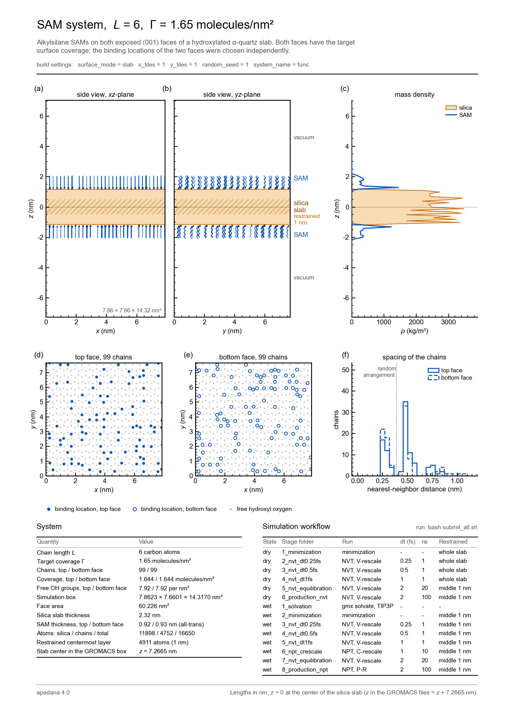

# SAM system L = 6, Γ = 1.65 molecules/nm²

Alkylsilane SAM on both faces of a hydroxylated α-quartz (001) silica slab, built with apadana.
Every molecule is bonded to a hydroxyl group of the surface chosen at random, and both faces
carry the target coverage. The binding locations of the two faces are drawn independently, and
the chains start in the all-trans conformation, aligned with the surface normal.



## System

| Quantity | Value |
| --- | --- |
| Chain length L (carbon atoms) | 6 |
| Target coverage (molecules/nm^2) | 1.65 |
| Chains per face | 99 |
| Chains in total | 198 |
| Actual coverage per face (molecules/nm^2) | 1.644 |
| Box (nm) | 7.8623 x 7.6601 x 14.3170 |
| Face area (nm^2) | 60.226 |
| Silica atoms (residue SUR) | 11898 |
| Alkylsilane atoms (residue OTS) | 4752 |
| Restrained middle-layer atoms | 4911 (central 1 nm of the slab) |
| Center of the silica slab, z (nm) | 7.2665 |

The z = 0 plane of the overview sheet corresponds to the z-axial geometrical center of the silica
slab, which lies at z = 7.2665 nm in the GROMACS box. Subtract this value from the z
coordinates of the box to measure z from the slab center.

## Build settings

| Setting | Value |
| --- | --- |
| chain_length | 6 |
| coverage | 1.65 |
| surface_mode | slab |
| x_tiles | 1 |
| y_tiles | 1 |
| vacuum_space_nm | 6 |
| restrained_layer_nm | 1 |
| surface_resname | SUR |
| sam_resname | OTS |
| system_name | func |
| random_seed | 1 |

## Files

| File | Content |
| --- | --- |
| `system_overview.pdf`, `system_overview.png` | one-page overview sheet: side views, density profile, binding locations on both faces, system data and workflow (lengths in nm, z = 0 at the slab center) |
| `system/func.gro` | coordinates (nm) |
| `system/func.pdb`, `system/func.mol2` | coordinates for visualization |
| `system/func.itp` | molecule definition: atoms, charges, masses and bonded terms |
| `system/topol.top` | topology of the dry system; includes the force fields of `system/ForceField/` |
| `system/topol_wet.top` | topology of the wet system: the same plus TIP3P water |
| `system/ForceField/` | CHARMM36 (chains), INTERFACE (silica), Si-C connection at the grafting point and CHARMM TIP3P water |
| `system/index.ndx` | groups Surface, Ots, Ots1 ... (one per chain) and midSurface |
| `system/POSRES_SUR.itp` | restraints of the whole slab (`define = -DPOSRES_SURFACE`) |
| `system/POSRES_MIDSUR.itp` | restraints of the middle layer of the slab (`define = -DPOSRES`) |
| `system/POSRES_OTS.itp` | restraints of the chain atoms (not used in the workflow) |
| `system/report_sizes.txt` | box size and grafting numbers |
| `system/func.top` | foyer topology from which `func.itp` was made |
| `mdp/` | the .mdp file of every stage |
| `run_*.sh`, `workflow_functions.sh`, `submit_all.sh` | scripts that run the workflow |

Written when the scripts run: `dry/` and `wet/` with one folder per stage, and
`system/index_wet.ndx` and `system/water_molecules.itp` when the system is solvated.

## Simulation workflow

The system is prepared stepwise before the production runs. Each stage starts from the end
structure (and checkpoint) of the stage before. The wet system is made by solvating the end
structure of dry stage 5 with water.

| State | Stage folder | Run | Time step (fs) | Length (ns) | Restrained silica |
| --- | --- | --- | --- | --- | --- |
| dry | 1_minimization | energy minimization (steepest descent) | - | - | whole slab |
| dry | 2_nvt_dt0.25fs | NVT, V-rescale | 0.25 | 1 | whole slab |
| dry | 3_nvt_dt0.5fs | NVT, V-rescale | 0.5 | 1 | whole slab |
| dry | 4_nvt_dt1fs | NVT, V-rescale | 1 | 1 | whole slab |
| dry | 5_nvt_equilibration | NVT, V-rescale | 2 | 20 | middle 1 nm |
| dry | 6_production_nvt | NVT, V-rescale | 2 | 100 | middle 1 nm |
| wet | 1_solvation | gmx solvate, TIP3P water | - | - | - |
| wet | 2_minimization | energy minimization (steepest descent) | - | - | middle 1 nm |
| wet | 3_nvt_dt0.25fs | NVT, V-rescale | 0.25 | 1 | middle 1 nm |
| wet | 4_nvt_dt0.5fs | NVT, V-rescale | 0.5 | 1 | middle 1 nm |
| wet | 5_nvt_dt1fs | NVT, V-rescale | 1 | 1 | middle 1 nm |
| wet | 6_npt_crescale | NPT, C-rescale, semi-isotropic | 1 | 10 | middle 1 nm |
| wet | 7_nvt_equilibration | NVT, V-rescale | 2 | 20 | middle 1 nm |
| wet | 8_production_npt | NPT, Parrinello-Rahman, semi-isotropic | 2 | 100 | middle 1 nm |

Every stage runs in its own folder, so the GROMACS output keeps its default names
(`confout.gro`, `traj_comp.xtc`, `ener.edr`, `md.log`, `state.cpt`; production runs
`dry/6_production_nvt/nvt.tpr` and `wet/8_production_npt/npt.tpr`).

## Running on an HPC cluster

1. Copy this folder to the cluster.
2. Check the SLURM lines at the top of the four `run_*.sh` scripts (account, partition, time).
3. In this folder: `bash submit_all.sh`. It submits
   `run_dry_relaxation.sh`, then `run_dry_production.sh` and `run_wet_relaxation.sh` (both wait
   for the dry relaxation), then `run_wet_production.sh` (waits for the wet relaxation).

A script can also be submitted alone (`sbatch run_dry_relaxation.sh`). Stages that are
finished are skipped, and an interrupted run continues from its checkpoint, so a job
that hits its time limit can be submitted again.

To check all input files without running MD (for example on a laptop):

```
GMX=gmx LAUNCH= GROMPP_ONLY=1 bash run_dry_relaxation.sh
```
